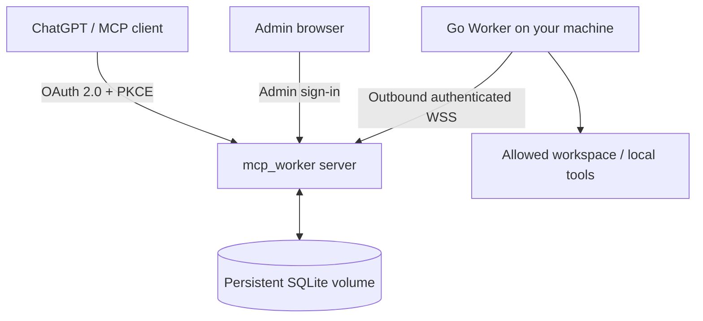

# mcp_worker

**A self-hosted MCP server that lets an authorized AI client use tools on your own machines through outbound Go Workers.** The server manages users, OAuth, Worker connections and audit records; the Worker performs approved file, Git, command and process operations.

> **Current status:** SQLite-only development baseline on [`main`](https://github.com/mathew15064/mcp_worker/tree/main). The server and Go Worker have passed local integration tests, but **public signed Worker installation is not yet released**. Use a disposable test environment until you have reviewed the [security model](docs/SECURITY_MODEL.md).

## How it works



- **One server, one SQLite volume:** no MySQL, Redis, external database or inbound SSH.
- **Outbound Workers:** the Worker initiates the authenticated WSS connection; the server does not connect via SSH or store SSH passwords.
- **15 MCP tools:** runtime info, Worker discovery, workspace commands, files, Git review, checks and managed processes.
- **Security boundaries:** OAuth scopes, Worker identity, owner access controls and audit records. A Worker executes with its **operating-system user's permissions**; allowed workspace paths do not sandbox arbitrary shell commands.

## Quick start: local Docker

Use the **source installer** for first-time setup. It builds the application image locally and generates the three required secrets. Requirements: Linux, Docker Engine, Compose v2, Git, OpenSSL, `flock` and network access to build dependencies.

```sh
git clone https://github.com/mathew15064/mcp_worker.git
cd mcp_worker
./setup.sh --init
curl -fsS http://127.0.0.1:3333/readyz
```

Open **http://127.0.0.1:3333/admin**. Sign in as `admin` with `ADMIN_PASSWORD` from the private `.env.setup` file. The installer binds HTTP to **localhost only**, creates a persistent SQLite volume and stores the password, session secret and encryption key in `.env.setup` (file mode `0600`).

To stop and restart without deleting data:

```sh
./setup.sh --down
./setup.sh
```

**Never run `docker compose down -v` on an installation whose data you need.** Keep `.env.setup` and the named `app-data` volume together for recovery. The `--init` command is for a **fresh** database, not an upgrade from MySQL.

For prerequisites, troubleshooting, OAuth testing and data recovery, see the [full installation guide](docs/QUICKSTART.md) and [backup/restore guide](docs/BACKUP_RESTORE.md).

## Docker Hub images

Development builds and historical release candidates are listed on [Docker Hub — mathew15604/mcp-worker](https://hub.docker.com/r/mathew15604/mcp-worker/tags). **Check the image tag and its Git revision before use**; a public image is not automatically a production-stable release.

You can pull a chosen tag with:

```sh
docker pull mathew15604/mcp-worker:<tag>
```

A pull only downloads an image. The recommended `./setup.sh --init` path above **builds from checked-out source**, initializes SQLite and configures credentials and the volume; it does not automatically use an image you just pulled. The previous `2.0.0-rc.2` image is historical, not this SQLite-only baseline.

## What can I test today?

| Feature | Local development status |
| --- | --- |
| Docker fresh install + persistent SQLite | Verified |
| Admin login, Users, OAuth 2.0 / PKCE | Verified |
| MCP registry (15 tools) | Verified |
| Go Worker WSS, authorization and execution | Verified in isolated integration tests |
| Browser/Admin UI | Verified with Chromium |
| Public signed Go Worker installer/binary downloads | **Unavailable — HTTP 503** |
| External HTTPS / ChatGPT OAuth / native OS installers | Not yet certified for public release |

**Important:** `/worker/install*` and `/worker/dist/*` deliberately return `503 WORKER_SIGNED_RELEASE_PENDING` until an owner-approved signed Worker release exists. The Docker server image may contain compiled Go binaries, but **that does not authorize unsigned public installation**. Do not bypass signature checks. For the future approved installation process, read [Worker documentation](worker/README.md).

## Available MCP tools

The server exposes exactly **15** authenticated tools:

| Purpose | Tools |
| --- | --- |
| Runtime and Worker discovery | `runtime_info`, `terminal_list` |
| Commands and artifacts | `workspace_exec`, `artifact_collect` |
| Files | `file_read`, `file_write`, `file_patch` |
| Source inspection | `repo_snapshot`, `git_diff`, `code_search` |
| Tests | `check_run` |
| Managed processes | `process_start`, `process_status`, `process_logs`, `process_stop` |

The legacy `bot_report.*` OAuth scopes, `BOT_REPORT_*` settings are retained for compatibility; the Go Worker CLI is `worker_mcp`; the interactive SSH tools have been retired.

## Documentation and contributions

- [Local setup](docs/QUICKSTART.md) · [Remote HTTPS / OAuth / ChatGPT](docs/REMOTE_MCP.md) · [Admin / development](docs/ADMIN_REFERENCE.md)
- [Go Worker lifecycle](worker/README.md) · [Security model](docs/SECURITY_MODEL.md) · [Troubleshooting](docs/TROUBLESHOOTING.md)
- [Release checklist](docs/RELEASE_CHECKLIST.md) · [Release engineering](docs/RELEASE_ENGINEERING.md) · [Dependencies and notices](docs/THIRD_PARTY_DEPENDENCIES.md)
- [Contributing](CONTRIBUTING.md) · [Security reporting](SECURITY.md) · [Changelog](CHANGELOG.md)

**License:** [MIT](LICENSE). Third-party dependencies retain their own licenses.
