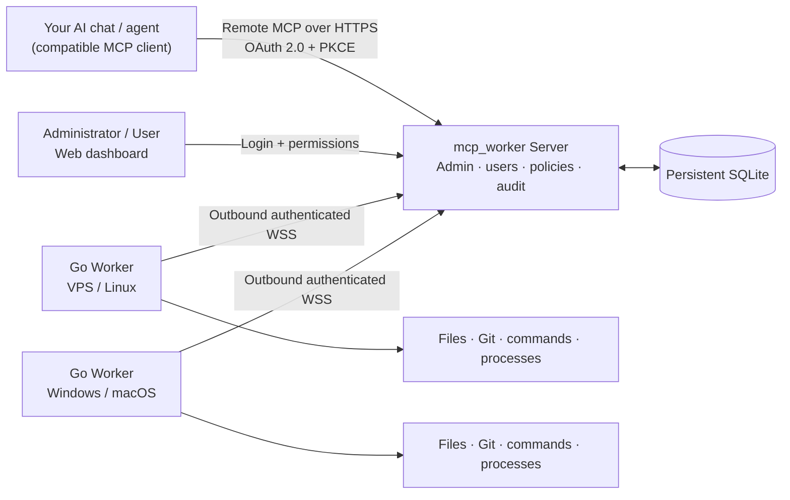

# mcp_worker

### Your AI. Your machines. Your rules.

**Connect an MCP-compatible AI assistant to your computers, servers, and development environments — without installing a coding agent on every machine.**

mcp_worker is a self-hosted **Model Context Protocol (MCP)** gateway with a lightweight, outbound-connecting Go Worker. It turns authorized AI conversations into controlled actions on machines you own: inspect files, review Git changes, run permitted commands, check tests, and manage processes.

**Bring your preferred AI client. Keep the execution infrastructure under your control.**

[](https://modelcontextprotocol.io/) [](#get-started) [](#step-2-install-a-worker-on-a-machine) [](LICENSE)

> **AI-client compatibility:** mcp_worker is *model-agnostic*, not *universally plug-and-play*. It can connect to chat or agent applications that support a **remote MCP server** and a compatible **OAuth 2.0 authorization-code / PKCE** flow. ChatGPT is one example; other clients can work when they implement the necessary protocol and authentication features. Availability, connector setup, tool approval, and OAuth support differ by product and plan. A chat app without compatible MCP support cannot connect directly.

---

## Why mcp_worker?

You shouldn't have to install a separate coding assistant on every VPS just to ask your AI to inspect a deployment.

**Traditional approach:** connect to each machine, set up a coding-agent runtime, manage its credentials, and repeat for every host.

**mcp_worker approach:** host **one MCP gateway**, install a **small Go Worker** on each trusted machine, and use compatible AI clients to call tools through centrally managed permissions.

| | mcp_worker |
| --- | --- |
| **AI experience** | Use an MCP-capable chat/agent client you already prefer |
| **Target-machine footprint** | Standalone Go Worker; no Codex CLI, Claude Code, Node.js, Python, or Docker required on the target |
| **Connectivity** | Worker makes an **outbound authenticated WebSocket (WSS)** connection; no inbound SSH service required by mcp_worker |
| **Access control** | Admin and user identities, Worker ownership, OAuth scopes, client authorization and revocation |
| **Visibility** | Admin dashboard, Worker presence, MCP request audit and tool activity |
| **Hosting** | Your own Docker MCP Server and persistent SQLite database |
| **Operations** | Files, repositories, commands, test/check execution and managed processes |

**This is a remote tool gateway, not another AI model or a replacement for your chat interface.** The AI client handles conversation and reasoning; mcp_worker brokers authorized tool requests; your Worker performs the action.

## How it works



1. You deploy a reachable **HTTPS MCP Server**.
2. You install and enroll a **Go Worker** on a trusted computer or VPS.
3. You register an OAuth client with the correct callback URI and scopes, then connect your MCP-capable AI client.
4. The AI sees the tools made available to its authorized identity. You select a Worker by its ID and approve tool use in your client as applicable.
5. The server checks authorization, forwards the operation to the connected Worker, and records activity.

The Worker runs with the permissions of its **OS account**. It is not a security sandbox: filesystem roots constrain path-based tools but do **not** constrain every possible shell command. Use a dedicated, least-privileged account and don't connect an untrusted machine.

## What can you ask your AI to do?

- **"Check my VPS."** Inspect an online Worker and run a targeted health command.
- **"Review this repository."** Inspect the Git state and changes without copying the whole working tree into the conversation.
- **"Find the configuration issue."** Read permitted files and search source code.
- **"Run the verification."** Trigger checks and inspect outputs.
- **"Restart the managed process."** Use process-management tools where configured and authorized.
- **"Compare my environments."** Discover multiple Workers and select the intended host explicitly.

These examples describe *available tool workflows*, not autonomous execution guarantees. Actual behavior depends on the AI client's capabilities, user approval, Worker access rights, and the permissions of the account running it.

## Features

**One gateway, many machines.** Connect multiple Workers and target immutable Worker UUIDs. The server exposes 15 MCP tools for discovery, execution, file operations, Git, code search, checks, and process management.

**BYO AI client.** The integration boundary is MCP + OAuth rather than a vendor-specific coding-agent protocol. No Codex CLI or Claude Code runtime is required on the managed host. A compatible AI client is still required on the chat side.

**Security you can actually operate.** Use scoped OAuth access (`mcp_worker.read`, `mcp_worker.terminal`), user/Worker ownership, expiring and revocable credentials, one-time Worker enrollment, and audit records. Admin is privileged; user-owned Workers are not automatically available to others.

**No inbound SSH dependency.** The Go Worker initiates its own WSS connection and authenticates with an identity key. The gateway doesn't require SSH passwords or an inbound Worker SSH port.

**A real web control plane.** Manage users, OAuth clients, Workers, server settings and activity from a browser. Optional **Cloudflare Turnstile** protects login/registration forms after successful configuration; it is disabled by default.

**Small infrastructure footprint.** One Docker server, one persistent SQLite volume, separately installed Go Workers. No Redis or MySQL required.

## Get started

There are **two separate installations**: the **MCP Server** (central gateway) and a **Go Worker** (one per machine you want to operate).

### Step 1 — Deploy the MCP Server

**Recommended: Quick Setup on a fresh Debian/Ubuntu VPS.**

Requirements: Docker Engine, internet access, root privileges for automatic HTTPS, and an available public HTTP-01 port **80**. HTTPS **443** (or your selected alternate port) must be reachable by clients. Review scripts before running them.

```bash
mkdir mcp_worker && cd mcp_worker
curl -fsSLO https://raw.githubusercontent.com/mathew15064/mcp_worker/main/quick-setup.sh
# Inspect quick-setup.sh before executing it.
sh quick-setup.sh --init
```

Quick Setup uses the published Docker Hub image, creates a private `.env.setup` and persistent SQLite storage, and provisions HTTPS with Nginx and Certbot when supported. No local source checkout or Node.js/Go build tools are needed. If an external HTTPS proxy is already in place, configure it explicitly:

```bash
MCP_WORKER_PUBLIC_URL=https://mcp.example.com \
  MCP_WORKER_TLS_MODE=external sh quick-setup.sh --init
```

An HTTPS URL with a trusted certificate is needed for **remote AI clients and Worker enrollment**. Verify the deployment:

```bash
curl -fsS https://YOUR_MCP_HOST/readyz
```

Open `https://YOUR_MCP_HOST/admin`, sign in with your setup credentials (kept in `.env.setup`), and configure users and Workers.

**Already have a deployment?** Keep its original `.env.setup` and SQLite volume. Do **not** rerun `--init` with a new directory, delete the volume, or regenerate credentials to bypass an existing-installation check. See [Quick Setup details](docs/QUICKSTART.md) and [backup/restore](docs/BACKUP_RESTORE.md).

### Step 2 — Install a Worker on a machine

**Worker is not Server.** Install the Worker on each machine you intend to access. The [signed standalone Worker v2.0.0 release](https://github.com/mathew15064/mcp_worker/releases/tag/v2.0.0) is separate from the server's Docker release.

For **Linux amd64 (including Debian/Ubuntu VPS)**, open **Admin → Workers → Install Worker → Linux** (or the account-owned **My Workers** view) and copy the **Quick Install** command shown by your server. The installer verifies the signed release, uses an isolated temporary download directory, and keeps the executable and identity in persistent user directories.

The Linux Quick Install uses the signed installer's `systemd` mode by default: it enables a `worker_mcp.service` to start at boot and restart on process exit. It requires root or passwordless sudo and a systemd host; it does not silently fall back to manual execution. Prefer a dedicated, non-root service account and verify its actual privileges.

Prefer to review the published installer yourself? The release offers `install-linux.sh`, plus [macOS](https://github.com/mathew15064/mcp_worker/releases/download/v2.0.0/install-macos.sh) and [Windows](https://github.com/mathew15064/mcp_worker/releases/download/v2.0.0/install-windows.ps1) scripts. For a **manual Linux install**:

```bash
curl -fsSLo install-linux.sh \
  https://github.com/mathew15064/mcp_worker/releases/download/v2.0.0/install-linux.sh
# Inspect install-linux.sh before running it.
sh install-linux.sh
export PATH="$HOME/.local/bin:$PATH"
```

The **manual** command above does not enable `systemd`. To install the managed service, use the current Linux Quick Install from your server or follow the [documented signed-service procedure](worker/README.md).

For **macOS** (review before execution):

```bash
curl -fsSLo install-macos.sh \
  https://github.com/mathew15064/mcp_worker/releases/download/v2.0.0/install-macos.sh
sh install-macos.sh
```

For **Windows PowerShell** (review before execution; OpenSSL must be available):

```powershell
Invoke-WebRequest https://github.com/mathew15064/mcp_worker/releases/download/v2.0.0/install-windows.ps1 -OutFile install-windows.ps1
.\install-windows.ps1
```

Windows/macOS installer lifecycle testing is not yet complete on native hosts. Detailed platform requirements, signature verification, upgrade and service instructions are in [Go Worker lifecycle](worker/README.md).

### Step 3 — Enroll the Worker

1. In **Admin → Workers**, generate a **one-time enrollment token** for an Admin-owned Worker; approved users can use their own **My Workers** flow.
2. On the target machine, run:

```bash
mcp_worker setup --server https://YOUR_MCP_HOST
mcp_worker status
mcp_worker connection test
mcp_worker logs
```

Enter the enrollment token at the interactive prompt; **never paste it into a public command, URL, chat, issue or log**. `connection test` checks server HTTPS readiness, while `status`, the dashboard and Worker presence confirm actual authenticated WSS connectivity.

Linux systemd users can also inspect:

```bash
systemctl is-enabled worker_mcp.service
systemctl status worker_mcp.service
journalctl -u worker_mcp.service -f
```

A verified and enrolled Worker preserves its local identity across compatible upgrades; do not delete `~/.worker_mcp` to troubleshoot a connection problem.

### Step 4 — Connect your preferred AI client

Use an AI chat/agent app with **remote MCP** and compatible **OAuth 2.0 + PKCE** support:

1. Create an OAuth client from **Admin → OAuth Clients**, or from the account owner's client workspace.
2. Use the **exact redirect/callback URI supplied by your AI client**; do not guess it or copy one from another platform.
3. Set the remote MCP endpoint to:

   ```text
   https://YOUR_MCP_HOST/mcp
   ```

4. Give the client its ID and one-time secret using the client's **private connector configuration**, never in the chat transcript.
5. Authorize as the intended owner. Start with `mcp_worker.read` and add `mcp_worker.terminal` only when remote command execution is actually needed.
6. Refresh the client's tools and try `runtime_info` followed by `terminal_list`. Select the appropriate Worker UUID for a harmless, read-only operation before permitting writes or shell commands.

**Examples of possible integrations:** ChatGPT or other MCP-capable assistants, desktop clients, IDEs, and agent front ends **when their specific version and account support remote MCP and this OAuth flow**. We do not claim every branded AI chat currently provides that support or has been integration-tested.

See the detailed [Remote MCP & OAuth guide](docs/REMOTE_MCP.md).

## MCP tools (15)

| Category | Tools | What they do |
| --- | --- | --- |
| Discovery | `runtime_info`, `terminal_list` | Server identity, registered Workers and connection state |
| Execution | `workspace_exec`, `artifact_collect` | Authorized commands and collected artifacts |
| Files | `file_read`, `file_write`, `file_patch` | Read, replace and patch files |
| Repositories | `repo_snapshot`, `git_diff`, `code_search` | Inspect source, changes and code |
| Checks | `check_run` | Run configured checks/tests |
| Processes | `process_start`, `process_status`, `process_logs`, `process_stop` | Start, inspect and stop managed tasks |

Tools accept `worker: "<UUID>"` for explicit Worker selection. Legacy `profile` arguments remain supported for compatible older workflows.

## Permissions and security model

Remote execution is powerful. mcp_worker provides **authorization and auditing**, **not an unconditional guarantee that an AI-generated command is safe**.

| Layer | Control |
| --- | --- |
| AI → MCP Server | OAuth authorization-code flow with PKCE; client permissions and revocable tokens |
| Users → resources | Admin/user ownership separation; account and Worker access checks |
| Worker → Server | Outbound WSS, signed Worker identity challenge, short-lived one-time enrollment |
| Tool invocation | OAuth scope checks and Worker ownership/selection restrictions |
| Visibility | Tool activity and MCP request audit; Admin monitoring |
| Host OS | Actual Unix/Windows account permissions, filesystem ACLs and any separate sandbox you configure |

**Recommended baseline:** use HTTPS; keep Admin credentials and encryption keys private; give each Worker a least-privileged OS account; grant terminal scope only where needed; avoid connecting compromised hosts; review audit logs and revoke lost credentials promptly.

Allowed workspace paths are **not** a complete sandbox for arbitrary shell commands. Workers running as root/Administrator inherit that authority. Do not expose Admin access to untrusted users.

Read the complete [Security Model](docs/SECURITY_MODEL.md) and [Security Reporting Policy](SECURITY.md).

## Configuration and operations

- **Admin dashboard:** Users, OAuth Clients, Workers, activity/audit and server settings.
- **Cloudflare Turnstile:** Optional CAPTCHA protection for Login/Registration via **Settings → Turnstile**. Enter Site Key and encrypted Secret Key, complete **Test configuration**, then enable. Monitoring shows aggregate verification results; it does not store CAPTCHA tokens.
- **Database:** Persistent SQLite with a private application encryption key. Preserve the original encryption key and credentials with backups.
- **Server restart:** From the original Quick Setup directory, use `sh quick-setup.sh --down` and `sh quick-setup.sh --start`; these preserve database and credentials.
- **Source development:** Clone the repository and run `./setup.sh --init` for a **fresh** source-mode instance only. This is separate from Quick Setup and uses different Docker volumes.

> **Signed distribution note:** Go Worker v2.0.0 is available as a separate [signed GitHub Release](https://github.com/mathew15064/mcp_worker/releases/tag/v2.0.0). MCP Server-hosted binary distribution endpoints `/worker/install*` and `/worker/dist/*` remain intentionally disabled (**HTTP 503**). Do not bypass signature verification or treat an arbitrary Docker tag as a signed Worker release.

## Project status

| Component | Status |
| --- | --- |
| Self-hosted Docker MCP Server, SQLite, Admin, OAuth | Available; tested in the project |
| 15 MCP tools and outbound Go Worker | Available; Linux and integration coverage |
| Linux signed standalone Worker v2.0.0 | Published |
| Linux Quick Install systemd mode | Available through the signed installer |
| macOS / Windows installers | Published; simulated QA, native lifecycle acceptance incomplete |
| Cloudflare Turnstile Admin configuration | Available; disabled until configured and tested |
| Third-party AI-client compatibility | Standards-based; validate each client's remote MCP/OAuth capabilities |

**Contributions welcome:** integrations, documentation, portability tests, security reviews and developer-experience improvements.

## Documentation

| Guide | Content |
| --- | --- |
| [Quickstart](docs/QUICKSTART.md) | Deploy the gateway, HTTPS and local development |
| [Remote MCP connection](docs/REMOTE_MCP.md) | HTTPS, OAuth, remote MCP clients |
| [Go Worker](worker/README.md) | Install, enroll, systemd, upgrades and signed releases |
| [Admin reference](docs/ADMIN_REFERENCE.md) | Settings, users and hosted behavior |
| [Security model](docs/SECURITY_MODEL.md) | Trust boundaries, scope and OS permissions |
| [Troubleshooting](docs/TROUBLESHOOTING.md) | Common failures |
| [Backup & restore](docs/BACKUP_RESTORE.md) | Protect SQLite data and encryption keys |
| [Release engineering](docs/RELEASE_ENGINEERING.md) | Build/sign/release policy |
| [Contributing](CONTRIBUTING.md) | Contribute and review changes |
| [Changelog](CHANGELOG.md) | Changes over time |

**License:** [MIT](LICENSE) · [Third-party dependencies and notices](docs/THIRD_PARTY_DEPENDENCIES.md).

---

**mcp_worker — one gateway to your machines, whichever compatible AI you choose.**