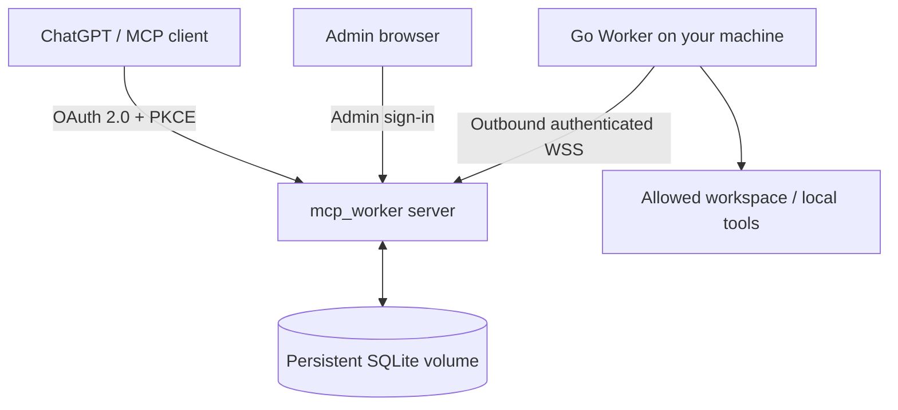

# mcp_worker

**A self-hosted MCP server that lets an authorized AI client use tools on your own machines through outbound Go Workers.** The server manages users, OAuth, Worker connections and audit records; the Worker performs approved file, Git, command and process operations.

> **Current status:** SQLite-only development baseline on [`main`](https://github.com/mathew15064/mcp_worker/tree/main). The server and Go Worker have passed local integration tests, but **public signed Worker installation is not yet released**. Use a disposable test environment until you have reviewed the [security model](docs/SECURITY_MODEL.md).

## How it works



- **One server, one SQLite volume:** no MySQL, Redis, external database or inbound SSH.
- **Outbound Workers:** the Worker initiates the authenticated WSS connection; the server does not connect via SSH or store SSH passwords.
- **15 MCP tools:** runtime info, Worker discovery, workspace commands, files, Git review, checks and managed processes.
- **Security boundaries:** OAuth scopes, Worker identity, owner access controls and audit records. A Worker executes with its **operating-system user's permissions**; allowed workspace paths do not sandbox arbitrary shell commands.

## Quick Setup — image first, no source checkout

Requires only Linux, Docker Engine and a small downloaded installer script. The server
image is already compiled on Docker Hub: **no Git, Go, Node.js, npm or Compose build**
required on the host.

```sh
mkdir mcp_worker && cd mcp_worker
curl -fsSLO https://raw.githubusercontent.com/mathew15064/mcp_worker/main/quick-setup.sh
# Review the downloaded script before running it; it controls your local Docker daemon.
sh quick-setup.sh --init
```

The script pulls `mathew15604/mcp-worker:dev-main` and creates a private
`.env.setup` (mode 0600) and fresh persistent SQLite volume. With no hostname
configured, it chooses an HTTPS origin based on the detected public IPv4
address (port 443 when free; port 3443 if a local listener already owns 443,
or the port explicitly selected via `MCP_WORKER_HTTPS_PORT`). With a hostname, specify
`MCP_WORKER_PUBLIC_URL=https://mcp.example.com`. For NAT, explicitly set
`MCP_WORKER_PUBLIC_IP`. The public origin is saved and **does not change
automatically** on restart.

**Important:** The Docker app listens only on `127.0.0.1:3333` when configured
for HTTPS; the host still needs a trusted certificate and an HTTPS reverse
proxy pointing at this backend. An HTTPS URL in `.env.setup` is **not proof
that TLS is installed**. Set up the IP/hostname certificate and proxy before
using public Admin, OAuth, or Worker WSS. IP certificates require a supported
ACME client (Certbot 5.4+ for webroot) and automated renewal because they
are short-lived. See [remote HTTPS guide](docs/REMOTE_MCP.md).

For an **existing HTTP Quick Setup installation** with a working trusted HTTPS
reverse proxy, run a deliberate, recoverable cutover from its original setup
directory:

```sh
MCP_WORKER_PUBLIC_URL=https://YOUR_IP:3443 sh quick-setup.sh --https
```

This checks public TLS first, makes a consistent SQLite backup, updates the
saved URL and database, and recreates only the container with loopback
backend, secure cookies and trusted proxy hop. Do **not** use `--init` on an
existing SQLite volume; it refuses to reinitialize an orphaned volume.

```sh
sh quick-setup.sh --down    # stop; keep credentials and database
sh quick-setup.sh --start   # restart same image and volume
```

Legacy HTTP installations retain their previous binding until an explicit
HTTPS cutover. `--rebind` is only for legacy HTTP and cannot expose a
secured backend. You can pin an immutable image with
`MCP_WORKER_IMAGE=docker.io/mathew15604/mcp-worker@sha256:...` on fresh setup.
No Docker Hub image, Go Worker binary, or public signed installer is published
by changing the URL; Worker distribution remains HTTP 503.

## Source Setup — developer workflow

```sh
git clone https://github.com/mathew15064/mcp_worker.git
cd mcp_worker
./setup.sh --init
```

This mode also publishes port 3333 on `0.0.0.0`; the same firewall and HTTPS
considerations apply.

This mode checks for a **matching local build** using its embedded Git revision
and source-tree SHA. When both match (including the locally cached Docker Hub image), it skips the build. Otherwise Docker builds
from the checked-out source. Use `MCP_WORKER_FORCE_BUILD=1 ./setup.sh` to force a
rebuild. `./setup.sh --down` preserves the source-mode SQLite volume
(`mcp_worker_app-data`) and `.env.setup`.

Both install modes require a **fresh SQLite volume**. Quick and Source modes use
**different** volume names to prevent concurrent writers. See the
[setup guide](docs/QUICKSTART.md) and [backup/restore](docs/BACKUP_RESTORE.md).

## Docker Hub images

Development builds and historical release candidates are listed on [Docker Hub — mathew15604/mcp-worker](https://hub.docker.com/r/mathew15604/mcp-worker/tags). **Check the image tag and its Git revision before use**; a public image is not automatically a production-stable release.

You can pull a chosen tag with:

```sh
docker pull mathew15604/mcp-worker:<tag>
```

A pull only downloads an image. Use **Quick Setup** for a no-clone install (Docker runs the image and generates credentials); use **Source Setup** when working on code. The historical `2.0.0-rc.2` tag is not this SQLite-only baseline.

## What can I test today?

| Feature | Local development status |
| --- | --- |
| Docker fresh install + persistent SQLite | Verified |
| Admin login, Users, OAuth 2.0 / PKCE | Verified |
| MCP registry (15 tools) | Verified |
| Go Worker WSS, authorization and execution | Verified in isolated integration tests |
| Browser/Admin UI | Verified with Chromium |
| Public signed Go Worker installer/binary downloads | **Unavailable — HTTP 503** |
| External HTTPS / ChatGPT OAuth / native OS installers | Not yet certified for public release |

**Important:** `/worker/install*` and `/worker/dist/*` deliberately return `503 WORKER_SIGNED_RELEASE_PENDING` until an owner-approved signed Worker release exists. The Docker server image may contain compiled Go binaries, but **that does not authorize unsigned public installation**. Do not bypass signature checks. For the future approved installation process, read [Worker documentation](worker/README.md).

## Available MCP tools

The server exposes exactly **15** authenticated tools:

| Purpose | Tools |
| --- | --- |
| Runtime and Worker discovery | `runtime_info`, `terminal_list` |
| Commands and artifacts | `workspace_exec`, `artifact_collect` |
| Files | `file_read`, `file_write`, `file_patch` |
| Source inspection | `repo_snapshot`, `git_diff`, `code_search` |
| Tests | `check_run` |
| Managed processes | `process_start`, `process_status`, `process_logs`, `process_stop` |

Current OAuth scopes are `mcp_worker.read` and `mcp_worker.terminal`; new runtime settings use `MCP_WORKER_*`. The Go Worker CLI/service is `worker_mcp`. The retired SSH commands and legacy names are not installed.

## Documentation and contributions

- [Local setup](docs/QUICKSTART.md) · [Remote HTTPS / OAuth / ChatGPT](docs/REMOTE_MCP.md) · [Admin / development](docs/ADMIN_REFERENCE.md)
- [Go Worker lifecycle](worker/README.md) · [Security model](docs/SECURITY_MODEL.md) · [Troubleshooting](docs/TROUBLESHOOTING.md)
- [Release checklist](docs/RELEASE_CHECKLIST.md) · [Release engineering](docs/RELEASE_ENGINEERING.md) · [Dependencies and notices](docs/THIRD_PARTY_DEPENDENCIES.md)
- [Contributing](CONTRIBUTING.md) · [Security reporting](SECURITY.md) · [Changelog](CHANGELOG.md)

**License:** [MIT](LICENSE). Third-party dependencies retain their own licenses.
