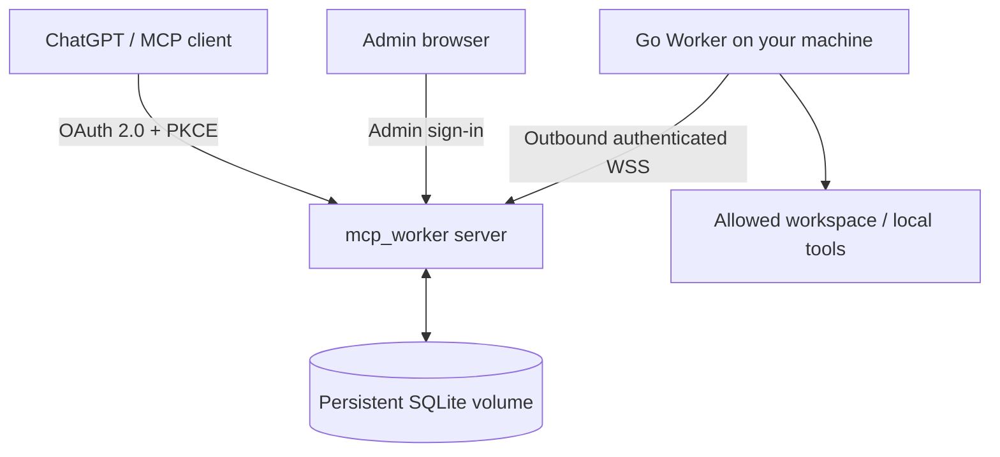

# mcp_worker

**A self-hosted MCP server that lets an authorized AI client use tools on your own machines through outbound Go Workers.** The server manages users, OAuth, Worker connections and audit records; the Worker performs approved file, Git, command and process operations.

> **Status:** Signed standalone Worker [v2.0.0](https://github.com/mathew15064/mcp_worker/releases/tag/v2.0.0) is publicly available from source commit `165d41aa0ba0479e3b54cc5f9d6b31bb43a9f26e`. Its GitHub release is **separate** from the Docker MCP Server on `main`. Windows/macOS installers passed simulated QA but not complete native OS acceptance.

## How it works



- **One server, one SQLite volume:** no MySQL, Redis, external database or inbound SSH.
- **Outbound Workers:** the Worker initiates the authenticated WSS connection; the server does not connect via SSH or store SSH passwords.
- **15 MCP tools:** runtime info, Worker discovery, workspace commands, files, Git review, checks and managed processes.
- **Hosted gateway v3:** `terminal_list` returns immutable Worker IDs; MCP tools accept
  `worker: "<UUID>"` directly. Existing `profile` tool arguments remain supported
  during migration, including aliases created by the signed standalone Worker v2.0.0.
  The Admin/User UI no longer requires creating Execution Profiles. Sessions for new
  Worker-ID calls use stable Worker IDs; historical alias sessions are preserved.
- **Security boundaries:** OAuth scopes, Worker identity, owner access controls and audit records. A Worker executes with its **operating-system user's permissions**; allowed workspace paths do not sandbox arbitrary shell commands.

## Install standalone Worker v2.0.0

**Worker is not MCP Server.** The Worker runs on a machine that will execute tasks and initiates an outbound authenticated WebSocket connection to an existing MCP Server. A prebuilt Worker needs no Node.js, npm, Python, Go, or Docker on the target. Installers come from the [official signed GitHub Release](https://github.com/mathew15064/mcp_worker/releases/tag/v2.0.0); Linux/macOS require `curl` and `openssl`, Windows requires PowerShell and OpenSSL in PATH.

**Linux amd64 (Debian/Ubuntu/VPS):** Open **Workers → Install Worker → Linux** and use **Copy Quick Install**. It downloads and runs the official signed-release installer from an isolated directory in `/tmp`, removes temporary files, exports `~/.local/bin` into the current Bash shell and adds the PATH line to `~/.bashrc` once. The **Advanced** section provides separate download, review, install and PATH commands if you prefer to inspect the script first.

The installer stores the runtime **persistently** at `~/.local/share/worker_mcp`, the CLI in `~/.local/bin`, and the identity in `~/.worker_mcp`. Only the **download and execution workspace** uses `/tmp`; do not put the identity or live runtime there. The quick command checks `mcp_worker version` automatically. Run it in your existing shell (not as a subprocess with `sh -c`) to retain the current-session PATH change. Use a least-privileged OS account where practical.

Enroll using a **one-time token** created in **My Workers → Install Worker** for your approved account, or **Admin → Workers** for administrator-owned Workers. Personal and Hosted Workers are account-owned and cannot be selected by other users. The CLI prompts for the token without echoing it; do not put tokens in commands, URLs or chats. This enrollment does **not** unlock server-hosted binary distribution (`/worker/install*` remains HTTP 503); use only the reviewed, signed GitHub Release.

```sh
mcp_worker setup --server https://YOUR_TRUSTED_MCP_SERVER
mcp_worker status
mcp_worker connection test
mcp_worker logs
```

`connection test` checks HTTPS health/readiness only; use `status` and Admin → Workers to verify authenticated WSS. A Worker executes with its OS user's permissions, so prefer a separate least-privileged account instead of root. For upgrades rerun the reviewed installer under the same account without deleting `~/.worker_mcp`.

**macOS:** Download and review [install-macos.sh](https://github.com/mathew15064/mcp_worker/releases/download/v2.0.0/install-macos.sh), then run `sh install-macos.sh`. **Windows:** Download and review [install-windows.ps1](https://github.com/mathew15064/mcp_worker/releases/download/v2.0.0/install-windows.ps1), then run it in PowerShell. Windows/macOS native lifecycle testing is incomplete (28 simulated cases passed). See [Worker documentation](worker/README.md).

## Quick Setup — image first, no source checkout

Requires a Debian/Ubuntu Linux VPS, Docker Engine and root permission for
**automatic HTTPS**. Quick Setup installs Nginx (if needed), isolated Certbot
5.4, a trusted IP/hostname certificate and a renewal timer. It never replaces
an existing Nginx virtual host; use `MCP_WORKER_TLS_MODE=external` if an
operator already manages TLS or runs another reverse proxy.
The server image is precompiled on Docker Hub: no host Git, Go, Node.js,
npm or Compose build is needed. Port **80** must be publicly reachable for
Let's Encrypt HTTP-01, and HTTPS **443** or the chosen alternative TLS port
must be open to clients.

```sh
mkdir mcp_worker && cd mcp_worker
curl -fsSLO https://raw.githubusercontent.com/mathew15064/mcp_worker/main/quick-setup.sh
# Review the downloaded script before running it; it controls your local Docker daemon.
sh quick-setup.sh --init
```

**Quick Setup installs the Docker MCP Server, not the standalone Worker.** If it reports `Existing data/container but .env.setup is missing`, Docker already has a server container or persistent SQLite volume but the current directory lacks the original `.env.setup`. Run from the original setup directory or restore the existing credentials. Do not delete Docker volumes or regenerate secrets merely to bypass the guard.

The script pulls `mathew15604/mcp-worker:dev-main` and creates a private
`.env.setup` (mode 0600) and fresh persistent SQLite volume. With no hostname
configured, it chooses an HTTPS origin based on the detected public IPv4
address (port 443 when free; port 3443 if a local listener already owns 443,
or the port explicitly selected via `MCP_WORKER_HTTPS_PORT`). With a hostname, specify
`MCP_WORKER_PUBLIC_URL=https://mcp.example.com`. For NAT, explicitly set
`MCP_WORKER_PUBLIC_IP`. The public origin is saved and **does not change
automatically** on restart.

**Automatic HTTPS (default):** After choosing the public IP or configured
hostname, Quick Setup downloads a second, SHA-256-pinned helper over HTTPS,
configures an exact Nginx virtual host, proves ACME control via staging,
obtains a production certificate, and enables a four-hour renewal timer.
The Docker backend binds only `127.0.0.1:3333`; the completed setup verifies
`https://YOUR_IP_OR_HOST/readyz` with certificate checking enabled. IP
certificates are short-lived (~160 hours). If DNS, firewall, certificate or
Nginx validation fails, the setup refuses to report success or fall back to
HTTP. Other Nginx sites are not replaced.

If TLS is already handled elsewhere, choose external mode explicitly:

```sh
MCP_WORKER_PUBLIC_URL=https://mcp.example.com \
  MCP_WORKER_TLS_MODE=external sh quick-setup.sh --init
```

In external mode, the operator must independently configure and verify the
trusted certificate, reverse proxy, and renewals. Do not enroll a Worker
until external HTTPS is working. See [remote HTTPS guide](docs/REMOTE_MCP.md).

For an **existing HTTP Quick Setup installation** with a working trusted HTTPS
reverse proxy, run a deliberate, recoverable cutover from its original setup
directory:

```sh
MCP_WORKER_PUBLIC_URL=https://YOUR_IP:3443 sh quick-setup.sh --https
```

This auto-provisions TLS if the target is not yet reachable (or uses
`MCP_WORKER_TLS_MODE=external` to leave proxy management to the owner),
then validates public TLS, makes a consistent SQLite backup, updates the
saved URL and database, and recreates only the container with loopback
backend, secure cookies and a trusted proxy hop. Do **not** use `--init` on an
existing SQLite volume; it refuses to reinitialize an orphaned volume.

```sh
sh quick-setup.sh --down    # stop; keep credentials and database
sh quick-setup.sh --start   # restart same image and volume
```

Legacy HTTP installations retain their previous binding until an explicit
HTTPS cutover. `--rebind` is only for legacy HTTP and cannot expose a
secured backend. You can pin an immutable image with
`MCP_WORKER_IMAGE=docker.io/mathew15604/mcp-worker@sha256:...` on fresh setup.
Changing the server URL does not publish Worker binaries. Server-hosted `/worker/install*` and `/worker/dist/*` endpoints still return HTTP 503 by design; the independently signed Worker v2.0.0 is distributed on GitHub Releases.

## Source Setup — developer workflow

```sh
git clone https://github.com/mathew15064/mcp_worker.git
cd mcp_worker
./setup.sh --init
```

This mode also publishes port 3333 on `0.0.0.0`; the same firewall and HTTPS
considerations apply.

This mode checks for a **matching local build** using its embedded Git revision
and source-tree SHA. When both match (including the locally cached Docker Hub image), it skips the build. Otherwise Docker builds
from the checked-out source. Use `MCP_WORKER_FORCE_BUILD=1 ./setup.sh` to force a
rebuild. `./setup.sh --down` preserves the source-mode SQLite volume
(`mcp_worker_app-data`) and `.env.setup`.

Both install modes require a **fresh SQLite volume**. Quick and Source modes use
**different** volume names to prevent concurrent writers. See the
[setup guide](docs/QUICKSTART.md) and [backup/restore](docs/BACKUP_RESTORE.md).

## Docker Hub images

Development builds and historical release candidates are listed on [Docker Hub — mathew15604/mcp-worker](https://hub.docker.com/r/mathew15604/mcp-worker/tags). **Check the image tag and its Git revision before use**; a public image is not automatically a production-stable release.

You can pull a chosen tag with:

```sh
docker pull mathew15604/mcp-worker:<tag>
```

A pull only downloads an image. Use **Quick Setup** for a no-clone install (Docker runs the image and generates credentials); use **Source Setup** when working on code. The historical `2.0.0-rc.2` tag is not this SQLite-only baseline.

## What can I test today?

| Feature | Local development status |
| --- | --- |
| Docker fresh install + persistent SQLite | Verified |
| Admin login, Users, OAuth 2.0 / PKCE | Verified |
| MCP registry (15 tools) | Verified |
| Go Worker WSS, authorization and execution | Verified in isolated integration tests |
| Browser/Admin UI | Verified with Chromium |
| Public signed standalone Worker installers/binaries | **GitHub Release v2.0.0 available** |
| Native Windows/macOS installer acceptance | Simulated QA passed; native lifecycle not fully tested |

**Important:** The MCP Server-hosted `/worker/install*` and `/worker/dist/*` endpoints deliberately remain HTTP 503. This does **not** mean the separate GitHub Release v2.0.0 is unavailable. Always verify signed installer artifacts; do not bypass signature checks.

## Available MCP tools

The server exposes exactly **15** authenticated tools:

| Purpose | Tools |
| --- | --- |
| Runtime and Worker discovery | `runtime_info`, `terminal_list` |
| Commands and artifacts | `workspace_exec`, `artifact_collect` |
| Files | `file_read`, `file_write`, `file_patch` |
| Source inspection | `repo_snapshot`, `git_diff`, `code_search` |
| Tests | `check_run` |
| Managed processes | `process_start`, `process_status`, `process_logs`, `process_stop` |

Current OAuth scopes are `mcp_worker.read` and `mcp_worker.terminal`; new runtime settings use `MCP_WORKER_*`. The Go executable remains `worker_mcp`; the signed standalone installer also exposes the `mcp_worker` CLI alias. Retired SSH commands are not installed.

## Documentation and contributions

- [Local setup](docs/QUICKSTART.md) · [Remote HTTPS / OAuth / ChatGPT](docs/REMOTE_MCP.md) · [Admin / development](docs/ADMIN_REFERENCE.md)
- [Go Worker lifecycle](worker/README.md) · [Security model](docs/SECURITY_MODEL.md) · [Troubleshooting](docs/TROUBLESHOOTING.md)
- [Release checklist](docs/RELEASE_CHECKLIST.md) · [Release engineering](docs/RELEASE_ENGINEERING.md) · [Dependencies and notices](docs/THIRD_PARTY_DEPENDENCIES.md)
- [Contributing](CONTRIBUTING.md) · [Security reporting](SECURITY.md) · [Changelog](CHANGELOG.md)

**License:** [MIT](LICENSE). Third-party dependencies retain their own licenses.
